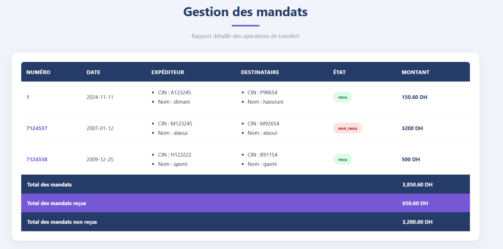
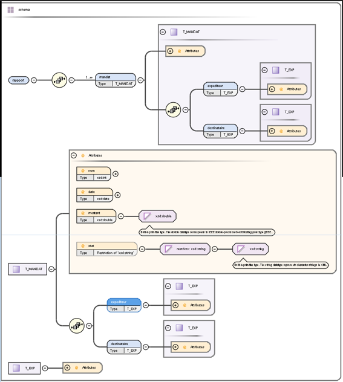

# Gestion des mandats

Projet XML/XML Schema/DTD/XSLT présentant un rapport détaillé des opérations de transfert de mandats.

## Aperçu

Le rapport contient :

- le numéro et la date du mandat ;
- les informations de l'expéditeur ;
- les informations du destinataire ;
- l'état du mandat : `recu` ou `non_recu` ;
- le montant du transfert ;
- les totaux des mandats reçus, non reçus et tous mandats confondus.

```text
+----------------------------------------------------------------+
|                    Gestion des mandats                         |
|       Rapport détaillé des opérations de transfert             |
|                                                                |
| NUMERO | DATE | EXPEDITEUR | DESTINATAIRE | ETAT | MONTANT   |
| ...                                                            |
| Total des mandats                                  3 850.60 DH |
| Total des mandats reçus                             650.60 DH  |
| Total des mandats non reçus                       3 200.00 DH |
+----------------------------------------------------------------+
```

### Interface du rapport



Le tableau présente les mandats, les expéditeurs, les destinataires, les états et les montants en DH.

### Schéma XML



Ce schéma représente la structure des mandats, des expéditeurs, des destinataires et de leurs attributs.

## Structure du projet

| Fichier | Description |
|---|---|
| `rapport.xml` | Exemple XML utilisant la DTD |
| `rapport.dtd` | Définition de la structure XML avec DTD |
| `rapport2.xml` | Exemple XML utilisant le schéma XSD |
| `rapport.xsd` | Schéma XML Schema (XSD) |
| `rapport.xsl` | Feuille de transformation XSLT vers HTML |
| `rapport.html` | Résultat HTML généré |
| `m2.html` | Exemple de graphique SVG |
| `.vscode/settings.json` | Configuration du port Live Server |

## Modèle XML

Exemple de mandat :

```xml
<?xml version="1.0" encoding="UTF-8"?>
<rapport>
    <mandat num="7124537"
            date="2007-01-12"
            montant="3200"
            etat="non_recu">
        <expediteur
            cin="M123245"
            nom="alaoui"
            prenom="mohamed"
            ville="marrakech"/>
        <destinataire
            cin="M92654"
            nom="alaoui"
            prenom="imane"
            ville="casa"/>
    </mandat>
</rapport>
```

### Déclaration DTD

La DTD imposée à `rapport.xml` est décrite dans `rapport.dtd` :

```dtd
<!ELEMENT rapport (mandat+)>
<!ELEMENT mandat (expediteur , destinataire)>

<!ATTLIST mandat
    num CDATA #REQUIRED
    date CDATA #REQUIRED
    montant CDATA #REQUIRED
    etat (recu|non_recu) "non_recu"
>
```

### Schéma XSD

`rapport2.xml` référence `rapport.xsd`. Chaque mandat possède les attributs `num`, `date`, `montant` et `etat`. Les éléments `expediteur` et `destinataire` possèdent les attributs `cin`, `nom`, `prenom` et `ville`.

```xml
<xsd:attribute name="etat" use="required">
    <xsd:simpleType>
        <xsd:restriction base="xsd:string">
            <xsd:enumeration value="recu"/>
            <xsd:enumeration value="non_recu"/>
        </xsd:restriction>
    </xsd:simpleType>
</xsd:attribute>
```

## Transformation XSLT

La feuille `rapport.xsl` parcourt les mandats puis calcule les totaux :

```xml
<xsl:for-each select="//mandat">
    <tr>
        <td><xsl:value-of select="@num"/></td>
        <td><xsl:value-of select="@date"/></td>
        <td><xsl:value-of select="expediteur/@nom"/></td>
        <td><xsl:value-of select="destinataire/@nom"/></td>
        <td><xsl:value-of select="@etat"/></td>
        <td><xsl:value-of select="@montant"/> DH</td>
    </tr>
</xsl:for-each>
```

Calcul du total général :

```xml
<xsl:value-of
    select="format-number(sum(//mandat/@montant), '#,##0.00')"/>
```

Calcul du total des mandats reçus :

```xml
<xsl:value-of
    select="format-number(
        sum(//mandat[@etat='recu']/@montant),
        '#,##0.00'
    )"/>
```

## Lancer le projet

1. Ouvrir le dossier dans Visual Studio Code.
2. Installer l'extension **Live Server**.
3. Ouvrir `rapport.html`.
4. Cliquer sur **Go Live**.
5. Utiliser l'adresse indiquée par Live Server (port `5503` configuré dans le projet).

Le fichier `rapport.html` est prêt à être ouvert directement dans un navigateur.

## Validation

- Valider `rapport.xml` avec `rapport.dtd`.
- Valider `rapport2.xml` avec `rapport.xsd`.
- Vérifier que les fichiers sont encodés en UTF-8 afin de conserver les caractères accentués.
